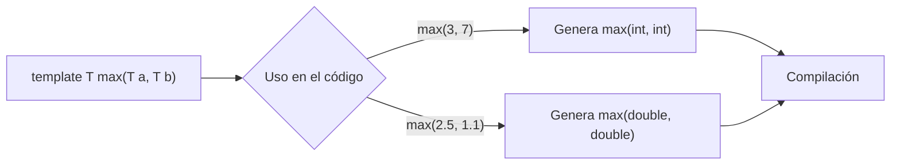

#  Templates y Generics (C++)

## 1. ¿Qué es un template?

Un **template** permite escribir el código **una sola vez** con un tipo de dato genérico (`T`) en lugar de repetirlo para `int`, `double`, `string`, etc.

>  Idea clave: `T` es un "comodín". El compilador lo reemplaza por el tipo real cuando lo usas.

```
 Sin template                     Con template
 ─────────────                    ─────────────
 int    max(int a, int b)         template <typename T>
 double max(double a, double b)   T max(T a, T b)
 string max(string a, string b)   (una sola versión)
```

## 2. Sintaxis básica

```cpp
template <typename T>   // también válido: template <class T>
T max(T a, T b)
{
    if (a >= b)
        return a;
    return b;
}
```

- Se declara con `template <typename T>` (los `<>` van con **ángulos**, no paréntesis).
- `T` puede llamarse como quieras, pero por convención es `T`.
- Se puede aplicar **a nivel de método (función)** o **a nivel de clase**.

### Uso

```cpp
max(3, 7);          // T = int      (deducido)
max(2.5, 1.1);      // T = double   (deducido)
max<string>("a", "b"); // T = string  (explícito)
```

| Forma | Ejemplo | ¿Cuándo? |
|---|---|---|
| Deducción automática | `max(3, 7)` | Los argumentos tienen el mismo tipo |
| Tipo explícito | `max<double>(3, 7.5)` | Tipos mezclados o ambiguos |

⚠️ `max(3, 7.5)` **no compila** sin especificar el tipo: `int` y `double` chocan al deducir `T`.

## 3. ¿Cómo funciona por dentro?



- El compilador **genera una versión por cada tipo** que uses (*instanciación*).
- Ocurre en **tiempo de compilación** → sin costo extra en ejecución.
- Si no usas el template, **no se genera código**.
- Por esto, los templates normalmente se escriben **completos en el `.h`** (no separados en `.cpp`).

## 4. Template a nivel de clase

```cpp
template <typename T>
class Stack
{
private:
    T data[10];
    int count;

public:
    Stack() : count(0) {}

    void push(T item);
    T pop();
    T peek() const;
    bool isEmpty() const;
    bool isFull() const;
    int size() const;
};
```

Aquí `T` aplica a **toda la clase**. Al usarla **siempre** debes indicar el tipo:

```cpp
Stack<int> pilaEnteros;
Stack<string> pilaTextos;
```

## 5. Pila completa (con excepciones)

```cpp
#include <stdexcept>

template <typename T>
class Stack
{
private:
    T data[10];
    int count;

public:
    Stack() : count(0) {}

    void push(T item)
    {
        if (count >= 10)
            throw std::overflow_error("Pila llena");
        data[count++] = item;      // guarda y luego incrementa
    }

    T pop()
    {
        if (count > 0)
            return data[--count];  // decrementa y luego devuelve
        throw std::underflow_error("Pila vacia");
    }

    T peek() const                 // ver el tope sin sacarlo
    {
        if (count == 0)
            throw std::underflow_error("Pila vacia");
        return data[count - 1];
    }

    bool isEmpty() const { return count == 0; }
    bool isFull()  const { return count == 10; }
    int  size()    const { return count; }
};
```

### Visual de la pila

```
push(5) → push(8) → push(2)         pop() → 2

 ┌───┐      ┌───┐      ┌───┐         ┌───┐
 │   │      │   │      │ 2 │ ← tope  │   │
 │   │      │ 8 │      │ 8 │         │ 8 │ ← tope
 │ 5 │      │ 5 │      │ 5 │         │ 5 │
 └───┘      └───┘      └───┘         └───┘
count=1    count=2    count=3       count=2
```

> 🔧 Ojo con las notas originales: en `push` faltaba **`count++`**, si no la pila nunca avanza.

### Ejemplo de uso

```cpp
Stack<int> s;
s.push(10);
s.push(20);
cout << s.peek();   // 20
cout << s.pop();    // 20
cout << s.size();   // 1
```

## 6. Más de un tipo genérico

```cpp
template <typename K, typename V>
class Par
{
public:
    K clave;
    V valor;
    Par(K k, V v) : clave(k), valor(v) {}
};

Par<string, int> edad("Jose", 20);
```

## 7. Parámetros que no son tipos (non-type)

Sirve para no dejar el tamaño "quemado" (el `10` de la pila):

```cpp
template <typename T, int N>
class Stack
{
    T data[N];
    int count = 0;
    // ...
};

Stack<int, 50> grande;
Stack<char, 5> chica;
```

Cada combinación `<T, N>` es **un tipo distinto** (`Stack<int,5>` ≠ `Stack<int,10>`).

## 8. Especialización (caso especial)

Cuando un tipo necesita un comportamiento distinto:

```cpp
template <typename T>
T max(T a, T b) { return (a >= b) ? a : b; }

// Especialización para const char* (compara texto, no direcciones)
template <>
const char* max<const char*>(const char* a, const char* b)
{
    return (strcmp(a, b) >= 0) ? a : b;
}
```

## 9. Requisitos sobre `T`

El template **no valida** el tipo por adelantado: simplemente falla al compilar si `T` no soporta lo que usas.

```cpp
// max(a, b) usa >=  →  T debe tener operator>=
struct Punto { int x, y; };
max(Punto{1,2}, Punto{3,4});   //  error: Punto no tiene operator>=
```

✅ Solución: sobrecargar el operador en la clase del tipo.

## 10. Templates vs. Generics

| | **Templates (C++)** | **Generics (Java / C#)** |
|---|---|---|
| Cuándo se resuelven | Compilación (se genera código por tipo) | Java: compilación + *type erasure*; C#: en ejecución |
| Tipos primitivos | ✅ `Stack<int>` | Java: ❌ (usa `Integer`); C#: ✅ |
| Parámetros non-type | ✅ (`int N`) | ❌ |
| Especialización | ✅ | ❌ |
| Errores | Mensajes largos y crípticos | Más claros |

## 11. Resumen rápido

-  `template <typename T>` → declara un tipo genérico.
-  Funciona en **funciones** y **clases**.
-  El compilador **genera una versión por tipo** usado.
-  Se implementan en el **`.h`**.
-  En clases se usa con `Clase<tipo>`.
-  Se pueden tener **varios `T`**, parámetros **non-type** y **especializaciones**.
